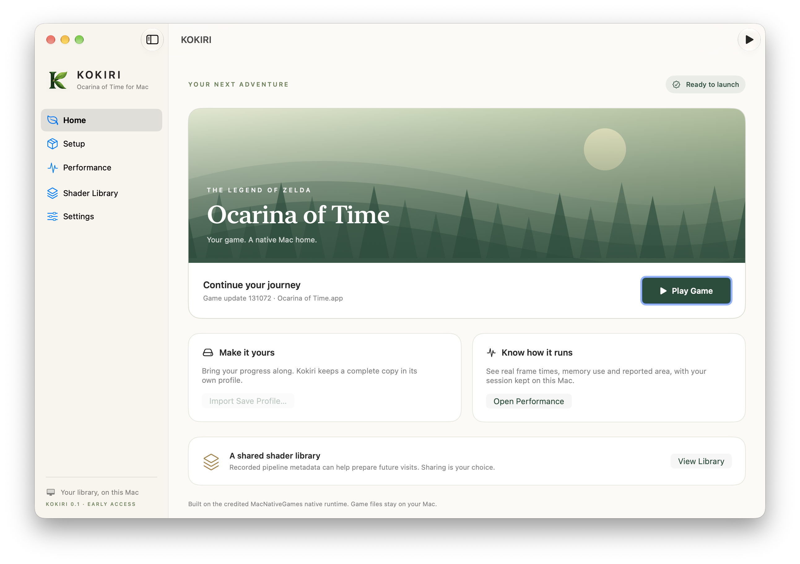

<p align="center">
  
</p>
<h1 align="center">Kokiri</h1>
<p align="center">Ocarina of Time. A home on your Mac.</p>
<p align="center">Apple silicon · macOS 26 · native ARM64 · Metal</p>

Kokiri is an independent Mac project built from the credited [MacNativeGames](https://github.com/ly05010419/MacNativeGames) native runtime. It brings a native game library, local session statistics and an open pipeline catalog into one Mac application. You build the game from your own files.

**Development preview.** The native app compiles and the public shader tools build from source. Fresh Kokiri gameplay verification is in progress. Major FPS drops, cold compilation hitches, high physical memory use and Death Mountain corruption remain open work. There is no stable release or live public catalog yet.



Actual native app window, 2026-11-15. This capture connects an existing compatible game build.

## The Mac experience

- **A native home.** Connect a built game, copy your complete save profile, and launch through a SwiftUI app. Existing progress stays in its original location.
- **Make the HUD yours.** Choose its corner, size and detail in Kokiri or the game menu. Matching runtimes advertise this capability; older apps keep their own controls.
- **See the session.** Inspect physical footprint, sampled area and optional frame timing. Recorded sessions carry their date and build; generated frames are excluded from the observed game rate.
- **Signed updates.** Sparkle integration supports automatic checks and downloads. Public release signing, the production feed and end-to-end installation tests are still required.

## A library other recompilers can use

The [open catalog protocol](docs/catalog/protocol.md) shares shader identities and pipeline recipes. Each compatible runtime builds its own native cache. Game, translation chain and compiler fingerprints keep incompatible records apart.

After a one-time choice, clients can queue contributions, deduplicate them and retry offline. The service quarantines new records before trusted publication. Downloads use a pinned signing key and content hashes. Contributions contain validated metadata; game files, shader source and player data stay local.

The first adapter supports the credited runtime's metadata format. Other projects can implement that format or contribute a versioned adapter. [Integration guide](docs/catalog/integration.md) · [Contribution flow](docs/catalog/contributions.md)

## Build it

You need Apple silicon, macOS 26 and Xcode. The supported game input is your own Nintendo Switch 2 dump of title `0400486024DEC000`, update `131072`; this build does not accept an N64 ROM. Game files and firmware fonts are not distributed here.

Build the native product app:

```sh
cd macos
bash test.sh
bash build.sh
open build/Kokiri.app
```

Build a private game app in an external workspace:

```sh
python3.14 engine/build.py /path/to/your/dump \
  --shared-fonts /path/to/your/shared-fonts \
  --work /path/to/Kokiri-work \
  -o '/path/to/Kokiri Game.app'
```

The builder verifies the supported input and rebuilds shader tooling from pinned source. Keep the work folder outside this checkout. See the [Mac app guide](macos/README.md) and [source provenance](engine/docs/kokiri-source-provenance.md).

## Performance, with evidence

We test movement, camera turns and repeated area transitions. We report game presentation rates separately from interpolation, and process physical footprint separately from reported Metal allocation.

The earlier runtime investigation completed a **789.84-second, five-cycle** copied-profile route with **15 measured windows**. The final nine windows had no presentation gaps above 100 ms, but the full-cycle physical-memory peak still rose by **485.95 MiB**. Those measurements used an experimental texture budget and the older v23 shader chain. They are a diagnostic baseline, not a Kokiri speed claim or a proven memory ceiling.

[Baseline and measurement limits](docs/performance.md)


Actual session viewer with an earlier v23 recording. These displayed figures are not new Kokiri gameplay results.

## Contribute

Start with [CONTRIBUTING.md](CONTRIBUTING.md). Useful reports include the build, Mac chip, output/internal resolution, pacing settings, area and a reproducible route. Please keep dumps, keys, saves, translated shaders and private logs out of issues and pull requests.

## Credits and license

MacNativeGames contributors built the native execution, service and graphics foundation. Kokiri retains their MIT copyright and the adjacent dependency notices. Sparkle provides the native updater. The catalog's initial reference dataset preserves its upstream attribution and MIT terms.

[MIT license](LICENSE) · [Engine dependency notices](engine/third_party/COPIES.md) · [Source revisions](engine/docs/kokiri-source-provenance.md)

Kokiri is an independent community project and is not affiliated with Nintendo. Game names identify the supported user-supplied software.
