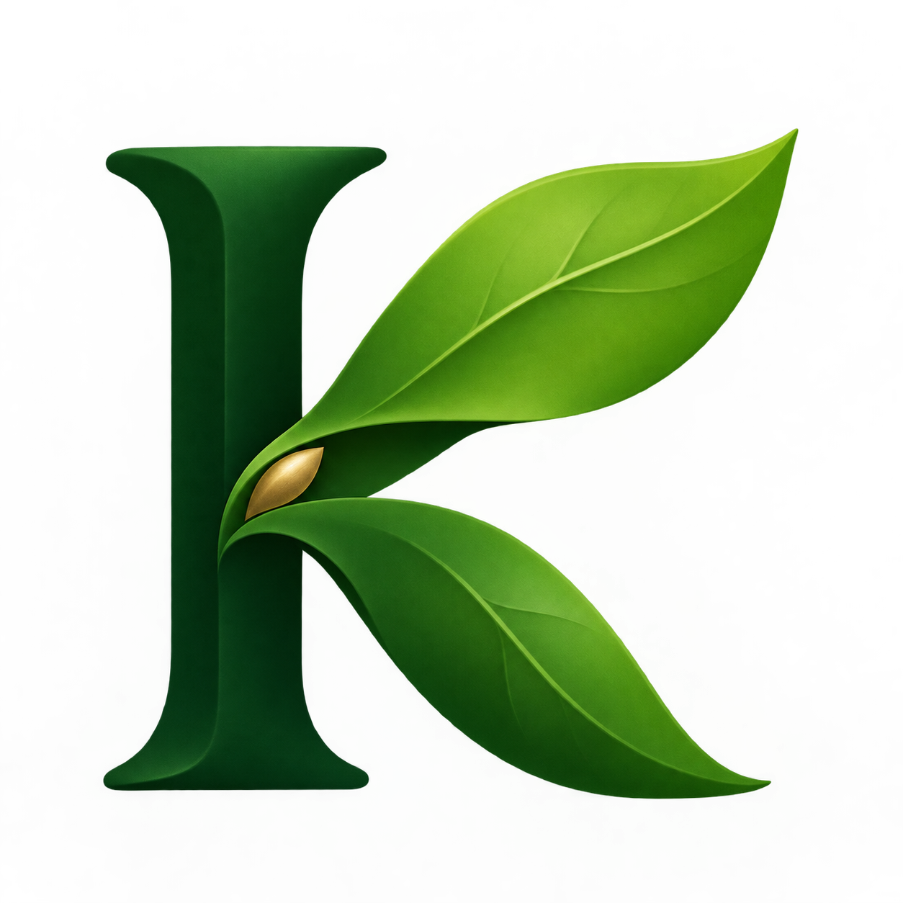

<p align="center">
  
</p>
<h1 align="center">Kokiri</h1>
<p align="center">Ocarina of Time for Apple silicon Macs.</p>
<p align="center">Apple silicon · macOS 26 · native ARM64 · Metal</p>

[](https://github.com/christianfurr/Kokiri/actions/workflows/checks.yml)

Kokiri brings the **Nintendo Switch 2 edition of Ocarina of Time** to Apple silicon Macs, with a native launcher, custom in-game settings and a configurable performance HUD. It builds on the credited [MacNativeGames](https://github.com/ly05010419/MacNativeGames) native ARM64 and Metal runtime. You build the game locally from your own files.

**Development preview.** Full v28 preparation remains incomplete, with no accepted playable package from the current full-v28 build. Severe FPS drops, compilation hitches and high memory use remain unresolved. The latest v28 user playtest reported no rendering corruption; broader visual checks remain open. See the dated [project status](STATUS.md) for preparation, catalog and update acceptance.

[Website & HUD preview](https://christianfurr.github.io/Kokiri/) · [Status](STATUS.md) · [Build guide](BUILDING.md) · [Documentation](docs/README.md) · [Report a problem](https://github.com/christianfurr/Kokiri/issues) · [Contribute](CONTRIBUTING.md)


Actual native app window, captured 2026-11-15 with an existing compatible game build.

## What Kokiri adds

- **A native Mac launcher.** Connect a compatible built game, import a copy of your complete save profile, and launch from SwiftUI. Your original profile stays in its original location.
- **A Kokiri welcome.** The original leaf-K appears in the Mac app icons and native startup screen, alongside observed loading phases and progress.
- **Custom in-game settings.** Open Kokiri's menu with **L3 + R3** or **key 1** on matching runtimes. The controller shortcut still needs physical-controller verification.
- **A configurable performance HUD.** Choose four corners, four sizes and three detail modes. Position, size and detail have been checked in gameplay and persist between launches.
- **Local session statistics.** Inspect physical memory use, sampled area and optional frame timing. Recordings show their date and build, and observed game rates exclude generated frames.

Kokiri also develops an **open shader and pipeline catalog** that compatible projects can integrate. The public protocol endpoint responds; a published dataset and verified native adoption remain pending. The launcher's signed-update plumbing uses Sparkle, alongside a separate runtime-source update path that rebuilds from your own assets. Production feeds, distribution signing and actual game update/relaunch/rollback acceptance remain pending.

## Try Kokiri

Source builds are for contributors while full-v28 preparation and package acceptance continue. Start with the requirements below and the [build guide](BUILDING.md). If you already have a compatible game app, the native launcher can connect to it; Kokiri-specific controls require a runtime that supports them.

| Requirement | Current support |
| --- | --- |
| Mac | Apple silicon |
| Operating system | macOS 26 |
| Build tools | Full Xcode with Metal toolchain; Python 3.14 or later for the game builder |
| Game input | Your own Nintendo Switch 2 dump, title `0400486024DEC000`, update `131072` |
| Other inputs | Your own six required shared firmware fonts and manifest; see the [build guide](BUILDING.md) |
| Distribution | Source preview; no stable, notarized download yet |

**This build does not accept an N64 or Nintendo 3DS ROM.** Game files, firmware fonts and generated game apps are not distributed in this repository.

## Help test and follow development

We need reproducible gameplay reports, especially from **Castle Town, Death Mountain and repeated area transitions**. Include your build, Mac chip, RAM, macOS version, internal/output resolution, frame-generation settings and the route that triggers the issue. Note whether it happens on a first visit or a repeat visit.

[Open an issue](https://github.com/christianfurr/Kokiri/issues) or read the [contribution guide](CONTRIBUTING.md). Keep dumps, keys, saves, translated shaders and private logs out of public attachments. Use GitHub's **Watch** menu to follow repository activity, or **Star** the project to bookmark it.

## A library other recompilers can use

The [open catalog protocol](docs/catalog/protocol.md) shares shader identities and pipeline recipes. Each compatible runtime builds its own native cache. Game, translation chain and compiler fingerprints keep incompatible records apart.

After a one-time choice, clients can queue contributions, deduplicate them and retry offline. The service quarantines new records before trusted publication. Downloads use a pinned signing key and content hashes. Contributions contain validated metadata; game files, shader source and player data stay local.

The first adapter supports the credited runtime's metadata format. Other projects can implement that format or contribute a versioned adapter. [Integration guide](docs/catalog/integration.md) · [Contribution flow](docs/catalog/contributions.md)

Native warm-plan adoption remains unaccepted. Records with unknown compiler target or effective options stay reference-only. Mesh pipelines and precompiled shader-library installs also remain reference-only; the catalog has no measured stutter-reduction result. See the [integration boundaries](docs/catalog/integration.md).

## Build from source

Use the [complete build guide](BUILDING.md) for owned inputs, full-preparation settings, storage and concurrency limits. Run these launcher commands from the repository root:

Build the native product app:

```sh
bash macos/test.sh
bash macos/build.sh
open macos/build/Kokiri.app
```

The private game app is a separate build through `engine/build.py`. It validates your supported local input and rebuilds shader tooling from pinned source. Keep its work folder and generated app outside this checkout. The launcher build does not complete runtime preparation.

## Gameplay status and performance

The [project status](STATUS.md) separates completed stages from pending package, gameplay, catalog and update acceptance. Source metadata totals do not count compiled shaders or pipelines.

New results need a matching build, hardware, resolution, tested route and cache state. We report actual game presentation rates separately from frame generation. We do not claim whole-game 60 FPS or a performance advantage over another project.

The [performance evidence and testing method](docs/performance.md) include an older v23 runtime diagnostic baseline. Those figures do not measure the current Kokiri build.


Actual session viewer displaying an earlier v23 recording. The displayed figures are historical observations, not current Kokiri benchmarks.

## Credits and license

MacNativeGames contributors built the native execution, service and graphics foundation. Kokiri retains their MIT copyright and the adjacent dependency notices. Sparkle provides the native updater. The save workshop derives from Traiver's OOT-SW2SE with Christian Furr's macOS adaptations. The catalog's initial reference dataset preserves its upstream attribution and MIT terms.

[MIT license](LICENSE) · [Credits & third-party notices](THIRD_PARTY_NOTICES.md) · [Engine dependency notices](engine/third_party/COPIES.md) · [Source revisions](engine/docs/kokiri-source-provenance.md)

Kokiri is an independent community project and is not affiliated with Nintendo. Game names identify the supported user-supplied software.
