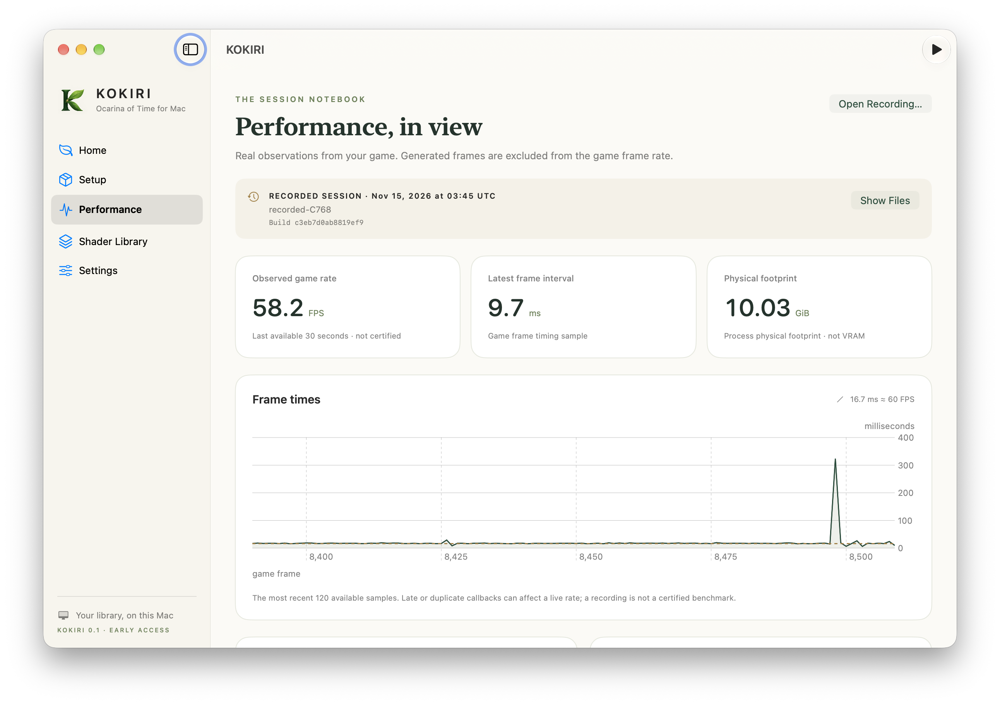

<p align="center">
  
</p>
<h1 align="center">Kokiri</h1>
<p align="center">Ocarina of Time for Apple silicon Macs.</p>
<p align="center">Apple silicon · macOS 26 · native ARM64 · Metal</p>

[](https://github.com/christianfurr/Kokiri/actions/workflows/checks.yml)

Kokiri brings the **Nintendo Switch 2 edition of Ocarina of Time** to Apple silicon Macs, with a native launcher, custom in-game settings and a configurable performance HUD. It builds on the credited [MacNativeGames](https://github.com/ly05010419/MacNativeGames) native ARM64 and Metal runtime. You build the game locally from your own files.

**Development preview.** There is no stable release yet. Full v28 preparation completed for the current private playtest: 42,466 compiled Metal libraries and 28,786 pipelines, including 196 mesh pipelines. The user reports smooth gameplay with occasional new pipeline compilation; broader performance, memory and visual acceptance remain open. The [public metadata catalog](https://catalog.christianfurr.dev) now serves 29,796 signed reference recipes.

[Website & HUD preview](https://christianfurr.github.io/Kokiri/) · [Build and try it](#try-kokiri) · [Report a problem](https://github.com/christianfurr/Kokiri/issues) · [Contribute](CONTRIBUTING.md) · [Catalog integration](docs/catalog/integration.md)


Actual native app window, captured 2026-11-15 with an existing compatible game build.

## What Kokiri adds

- **A native Mac launcher.** Connect a compatible built game, import a copy of your complete save profile, and launch from SwiftUI. Your original profile stays in its original location.
- **A Kokiri welcome.** The original leaf-K appears in the Mac app icons and native startup screen, alongside observed loading phases and progress.
- **Custom in-game settings.** Open Kokiri's menu with **L3 + R3** or **key 1** on matching runtimes. The controller shortcut still needs physical-controller verification.
- **A configurable performance HUD.** Choose four corners, four sizes and three detail modes. Position, size and detail have been checked in gameplay and persist between launches.
- **Local session statistics.** Inspect physical memory use, sampled area and optional frame timing. Recordings show their date and build, and observed game rates exclude generated frames.

Kokiri also develops an **open shader and pipeline catalog** that compatible projects can integrate. The launcher's signed-update plumbing uses Sparkle. Production signing, a public feed and end-to-end game-runtime update verification remain pending; updating the launcher alone does not update the game built from your own files.

## Try Kokiri

This preview currently requires a source build. Start with the requirements below, then follow the [build instructions](#build-from-source). If you already have a compatible game app, the native launcher can connect to it; Kokiri-specific controls require a runtime that supports them.

| Requirement | Current support |
| --- | --- |
| Mac | Apple silicon |
| Operating system | macOS 26 |
| Build tools | Xcode; Python 3.14 for the game builder |
| Game input | Your own Nintendo Switch 2 dump, title `0400486024DEC000`, update `131072` |
| Other inputs | Your own required shared firmware fonts; see the builder instructions |
| Distribution | Source preview; no stable, notarized download yet |

**This build does not accept an N64 or Nintendo 3DS ROM.** Game files, firmware fonts and generated game apps are not distributed in this repository.

## Help test and follow development

We need reproducible gameplay reports, especially from **Castle Town, Death Mountain and repeated area transitions**. Include your build, Mac chip, RAM, macOS version, internal/output resolution, frame-generation settings and the route that triggers the issue. Note whether it happens on a first visit or a repeat visit.

[Open an issue](https://github.com/christianfurr/Kokiri/issues) or read the [contribution guide](CONTRIBUTING.md). Keep dumps, keys, saves, translated shaders and private logs out of public attachments. Use GitHub's **Watch** menu to follow repository activity, or **Star** the project to bookmark it.

## A library other recompilers can use

The [open catalog protocol](docs/catalog/protocol.md) shares shader identities and pipeline recipes. Each compatible runtime builds its own native cache. Game, translation chain and compiler fingerprints keep incompatible records apart.

After a one-time choice, clients can queue contributions, deduplicate them and retry offline. The service quarantines new records before trusted publication. Downloads use a pinned signing key and content hashes. Contributions contain validated metadata; game files, shader source and player data stay local.

The first adapter supports the credited runtime's metadata format. Other projects can implement that format or contribute a versioned adapter. [Integration guide](docs/catalog/integration.md) · [Contribution flow](docs/catalog/contributions.md)

Native warm-plan integration is being verified. Its first path accepts ordinary compute/render recipes with locally verified Metal JIT variants. Mesh pipelines and precompiled shader-library installs remain reference-only; the catalog does not yet remove their observed compilation stalls.

## Build from source

Check the [requirements](#try-kokiri) before building. The launcher and the private game app are separate builds.

Build the native product app:

```sh
cd macos
bash test.sh
bash build.sh
open build/Kokiri.app
```

Build a private game app in an external workspace:

```sh
python3.14 engine/build.py /path/to/your/dump \
  --shared-fonts /path/to/your/shared-fonts \
  --work /path/to/Kokiri-work \
  -o '/path/to/Kokiri Game.app'
```

The builder verifies the supported input and rebuilds shader tooling from pinned source. Keep the work folder outside this checkout. See the [Mac app guide](macos/README.md) and [source provenance](engine/docs/kokiri-source-provenance.md).

## Gameplay status and performance

| Area | Current status |
| --- | --- |
| Native launcher | Compiles; Home and Performance screenshots show the implemented app |
| Custom menu and HUD | Checked in a copied-profile gameplay session; physical L3 + R3 verification remains open |
| Whole-game performance | Unverified; severe FPS drops, compilation stalls and memory growth remain open |
| v28 visual correctness | No corruption reported in the latest user playtest; broader area and visual checks remain open |
| v28 shader preparation | Complete for the current private build; preparation does not guarantee every gameplay specialization is covered |
| Public metadata catalog | Live signed reference dataset; native downloads remain separate from game caches |
| Automatic updates | Plumbing tested; production signing and distribution remain pending |

New results need a matching build, hardware, resolution, tested route and cache state. We report actual game presentation rates separately from frame generation. We do not claim whole-game 60 FPS or a performance advantage over another project.

The [performance evidence and testing method](docs/performance.md) include an older v23 runtime diagnostic baseline. Those figures do not measure the current Kokiri build.



Actual session viewer displaying an earlier v23 recording. The displayed figures are historical observations, not current Kokiri benchmarks.

## Credits and license

MacNativeGames contributors built the native execution, service and graphics foundation. Kokiri retains their MIT copyright and the adjacent dependency notices. Sparkle provides the native updater. The catalog's initial reference dataset preserves its upstream attribution and MIT terms.

[MIT license](LICENSE) · [Engine dependency notices](engine/third_party/COPIES.md) · [Source revisions](engine/docs/kokiri-source-provenance.md)

Kokiri is an independent community project and is not affiliated with Nintendo. Game names identify the supported user-supplied software.
